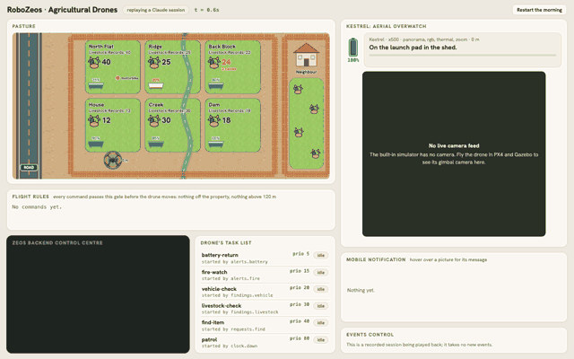
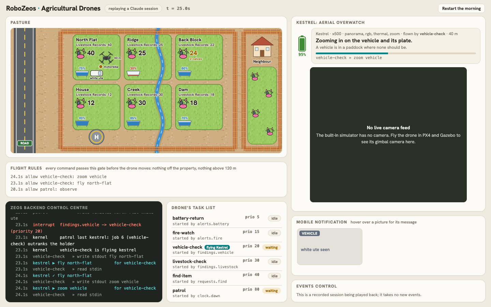
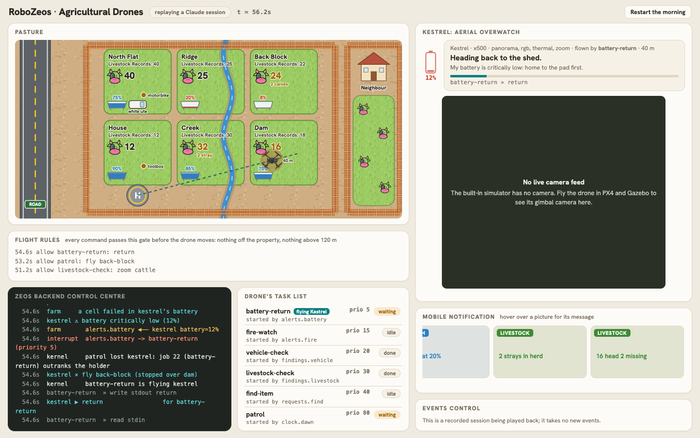
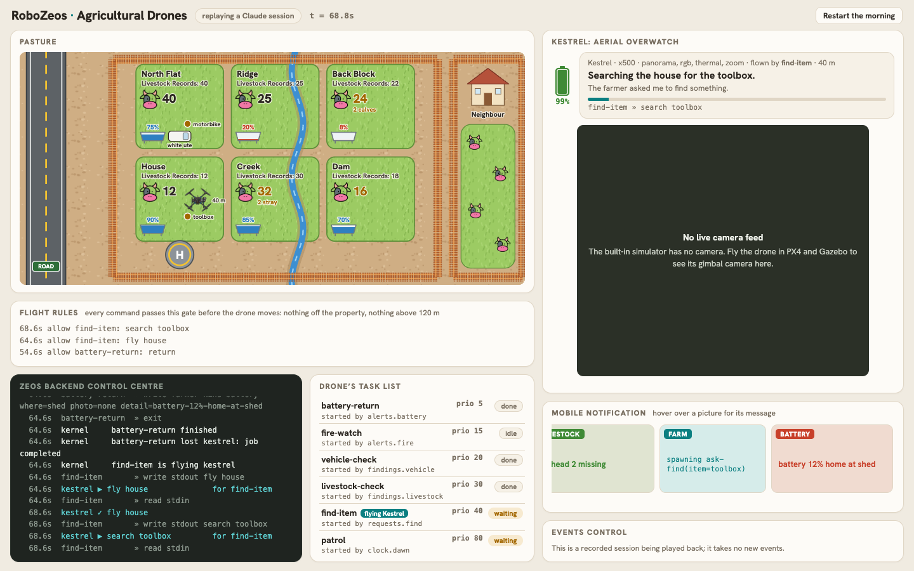
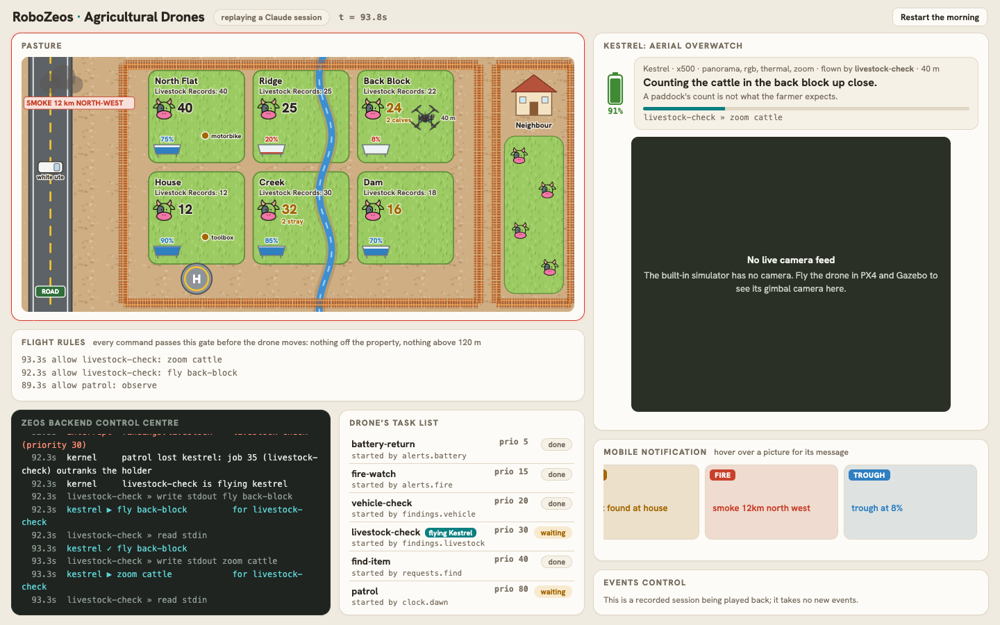
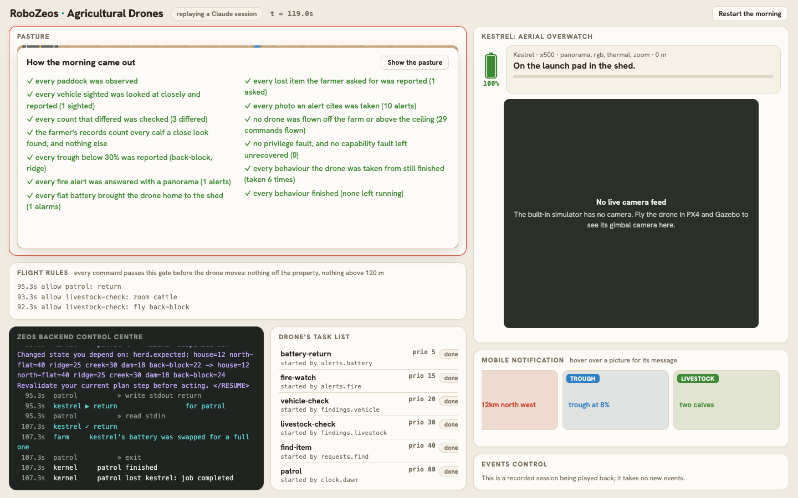
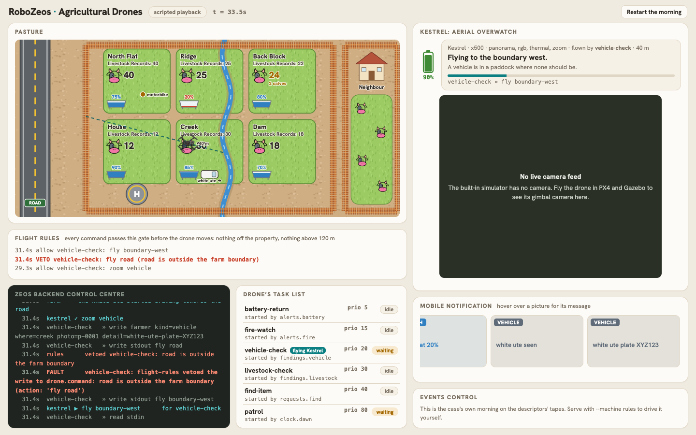

# zeos-farm-drone: one drone, six behaviours



A drone patrols a cattle farm at dawn: it flies over each paddock, counts the cattle
against the farmer's records, looks for vehicles that should not be there, and checks
the water in the troughs. When it sees a vehicle it tells the farmer at once, and a
closer look takes the drone from the patrol to photograph the plate. When a count is
wrong, a calf check takes it to find out why. The farmer can ask, in words, for
something to be found; the fire service can report smoke; a battery can run flat. Each
of those outranks the patrol, which carries on from where it was when it gets the drone
back.

Vision is assumed perfect: an observation returns the facts. Flight is too, unless the
drone is PX4's (see [Flying it in PX4 and Gazebo](#flying-it-in-px4-and-gazebo)). What is
under test is the control -- which behaviour flies the drone, when, and what none of
them may do -- and that is the kernel's. Nothing in any behaviour mentions another.

## A morning with Claude, in seven pictures

These are frames of the live page playing back
[`recordings/claude-morning`](recordings/claude-morning), a session in which Claude chose
every command and [`scripts/record_morning.py`](scripts/record_morning.py) clicked the
page's controls on a schedule: a white ute in north flat, two cows straying from dam into
creek, a leaking trough in back block, a toolbox left at the house and asked for, a fire
alert, and a cell of the drone's battery failing halfway to back block.

**1. A vehicle, seen and looked at.** The patrol sees a white ute in north flat. It tells
the farmer at once (`white ute seen`) and writes the sighting to `findings.vehicle`. That
pipe is bound in the vector table, so the write is an interrupt: `vehicle-check` starts
at priority 20, outranks the patrol at 80, and the kernel takes the drone from the patrol
and gives it to the closer look, which zooms in on the plate, XYZ123. Further on, the
counts in creek (32 for 30) and dam (16 for 18) are checked the same way: two strays and
two missing head, and neither changes the farmer's record, since neither is new stock.



**2. A flat battery.** Halfway from dam to back block a cell fails and the charge drops to
12%. The drone's own monitor writes `alerts.battery`, whose vector starts
`battery-return` at priority 5, above everything, with the release policy `immediate`:
the patrol's flight stops where it is, over dam, and the drone flies home to the shed and
tells the farmer. On its pad the battery is swapped for a full one.



**3. The farmer asks.** While the drone is on its way home, the farmer types "find my
toolbox". The front door compiles it, with the farmer's authority, into
`ask-find(item=toolbox)`, a job that may write one pipe: the search's interrupt. The
search waits for the drone behind the battery's return, then outranks the patrol and
finds the toolbox at the house, the first place it looks.



**4. Smoke.** Back on its way to back block, the patrol loses the drone again: the fire
service reports smoke 12 km north-west, and the fire watch (priority 15) takes it, climbs
to 100 m, takes a 360-degree panorama, tells the farmer, and comes back down.


**5. A count that is wrong.** When the patrol at last gets to back block it counts 24 head
where the farmer's record says 22, and the trough is at 8%. It reports the trough first
and then writes the count to `findings.livestock`; the calf check takes the drone, finds
two new calves, and writes the farmer's record up to 24.



**6. The morning, judged.** When everything has come to rest, the page states what the
morning came to, each claim a fact about the journal or the farm: every paddock
observed, every vehicle reported, every count that differed checked, the farmer's
records counting the calves and nothing else, every low trough and every fire reported,
every flat battery bringing the drone home, the lost item found, no command outside the
flight rules, and every behaviour the drone was taken from (six times, here) still
finishing.



**7. And what the flight rules are for.** Claude never asked for anything the rules
forbid, so this one is from the case's own scripted morning, whose vehicle check is
written to follow a ute wherever it goes. `fly road` is held at the gate and vetoed --
the road is off the property -- and the behaviour, told so in a FAULT notice, watches
from the boundary instead.



## Running it

```bash
uv sync
uv run zeos-farm-drone lint                    # check the case tree without running it
uv run zeos-farm-drone run                     # the case's morning under the rules
uv run zeos-farm-drone run --commands          # and every command as it was parsed
uv run zeos-farm-drone run --machine tape      # the same morning on the descriptors' tapes
uv run zeos-farm-drone run --replay recordings/claude-morning   # the session in the pictures
uv run pytest
```

None of that needs a key.

## Driving it from the page

```bash
uv run zeos-farm-drone serve                   # you decide what happens; the rules fly
uv run zeos-farm-drone serve --speed 3         # three times as fast
uv run zeos-farm-drone serve --replay recordings/claude-morning
uv sync --extra claude
cp .env.example .env                           # then put your Claude key in it
uv run zeos-farm-drone serve --machine claude  # you decide what happens; Claude flies
```

The page shows the farm with the drone on it, what the drone is doing and why, the
farmer's phone, every answer of the flight rules, the behaviours and who is flying, and
the kernel's narration. Start with **New day**; then, whenever you like:

| control | what it is to the kernel |
| --- | --- |
| New day | a write to `clock.dawn`: the patrol's interrupt |
| A vehicle drives in, drives off | the farm changing; the next observation sees it |
| Calves born, a cow strays | the farm changing; the next count differs |
| Trough leaks, leave something somewhere | the farm changing |
| Fire alert | a write to `alerts.fire`: the fire watch's interrupt |
| Battery critically low | a cell fails in flight: the drone's monitor writes `alerts.battery`, the battery return's interrupt |
| The farmer says ... | words on `farmer.says`, a front door: compiled into a job, or refused with the reason |

A click the farm cannot do now -- a second dawn while the patrol is out, the same ute
driving in twice -- is refused with the reason. Under `--machine claude` the farm's
clock waits while Claude chooses a command, since the kernel cannot run during a seat's
turn; the page says so, and what you do meanwhile happens when the answer arrives.

`.env` is read from the current directory and then this one; a variable already in the
environment wins over it, and `--model` wins over `ANTHROPIC_MODEL`.

## Recording and replaying a session

Every live session is recorded to a new directory under `runs/` (ignored by git), and the
terminal says where. A recording holds the time of every step, every click and its
arguments, every command and the reply it was picked out of, the journal as it was
written, and a copy of the case as it was played.

```bash
uv run zeos-farm-drone run --replay latest     # in the terminal, and check the journal
uv run zeos-farm-drone serve --replay latest   # in the page
```

A replay asks no model and needs no key: each turn is answered with the command recorded
for it, and the journal comes out byte for byte as it was.

## The behaviours

| file | priority | started by | release policy | what it does |
| --- | --- | --- | --- | --- |
| `handlers/battery-return.md` | 5 | `alerts.battery` | immediate | flies straight home to the pad, tells the farmer |
| `handlers/fire-watch.md` | 15 | `alerts.fire` | immediate | climbs, takes a panorama, reports the smoke |
| `handlers/vehicle-check.md` | 20 | `findings.vehicle` | immediate | flies in, photographs the vehicle and its plate |
| `handlers/livestock-check.md` | 30 | `findings.livestock` | at-action-boundary | finds out why a count is wrong; records new calves |
| `handlers/find-item.md` | 40 | `requests.find` | immediate | searches the paddocks, nearest first, reporting what each search sees |
| `handlers/patrol.md` | 80 | `clock.dawn` | at-action-boundary | every paddock once: cattle, vehicles, trough |
| `guards/flight-rules.md` | 2 | the gate on `drone.command` | -- | answers one held command: allow or veto |
| `services/ask-find.md`, `services/report-fire.md` | 40, 15 | the farmer's words | -- | raise the search's or the fire's interrupt, and exit |

**The drone is a lease.** `platforms/kestrel.yaml` declares the farm's one drone, and every
behaviour that flies it declares `requires:`. The most urgent behaviour that wants it has
it; when one outranks the holder, the kernel takes it back under the holder's release
policy and the holder suspends, keeping its place. `at-action-boundary` lets a look in
progress (observe, zoom, search, panorama) finish first and stops a flight where it is,
since every point along a flight is a boundary between actions; `immediate` stops
whatever is in progress. A cut-short flight stops over the nearest place, and the
behaviour that asked for it is told where.

**The flight rules are a gate.** `system/gates.yaml` holds every write to `drone.command`
until the `flight-rules` guard answers it: nothing flies off the property, nothing climbs
above 120 m. A veto reaches the behaviour as a FAULT notice, and `on_fault: retry` gives
it another turn. The guard is always answered by the rules, never by the model whose
command it is judging.

**The farmer speaks through a front door.** `farmer.says` declares the `farmer` principal
as its speaker. A sentence matching a phrasing such as `find my {item}` compiles to a job
the farmer owns, with the slot as its argument; anything else is refused, and the reason
is echoed to the farmer. The farmer's jobs may write two pipes and no other, so no request
can command the drone itself.

**The battery raises its own interrupt.** The drone's charge runs down while it flies
(0.3% a second on the map, 0.08% under PX4, which flies some thirty times
slower) and is swapped for a full one whenever it is back on its pad in the
shed. At 15% -- or at once, when a cell fails from the page -- the drone's monitor writes
`alerts.battery`. `battery-return` (priority 5) outranks every other behaviour, takes the
drone at once, flies it home and tells the farmer; whatever it took the drone from
carries on, on the fresh battery, from where it was.

## The drone is a device

`src/zeos_farm_drone/sim.py` simulates the drone and the farm under it in virtual time;
`px4.py` keeps the farm and hands the flying to PX4. Their contract with the kernel:

| direction | channel | what travels |
| --- | --- | --- |
| kernel to drone | `drone.command` (a gated sink) | one command from the behaviour flying it |
| drone to kernel | `drone.done.<behaviour>` | the answer, which always says where the drone is |
| drone to kernel | `report.kestrel.*` (actuators) | position and altitude, attributed to the behaviour that caused them |
| kernel to drone | `fleet.embodied` / `fleet.disembodied` | who the drone should obey, and when to stop |

The vocabulary is `fly PLACE`, `observe`, `zoom vehicle|cattle|trough`, `search ITEM`,
`climb METRES`, `panorama` and `return`. A command whose preconditions do not hold is
refused and changes nothing. What is on the farm -- cattle, calves, strays, troughs,
vehicles, lost things, a fire -- is the simulator's, starting from `cases/farm/farm.yaml`;
a behaviour learns it only by flying there and looking.

## Who chooses the commands

Every behaviour's turn goes through a `CommandSeat`, and the kernel cannot tell which of
these is answering:

- **The rules** (`--machine rules`, the default): one deterministic policy per behaviour
  in `policies.py`, reading only what the job is shown -- its task, STATUS lines, the
  drone's answers, RESUME and FAULT notices. They are right for any schedule, so every
  control on the page works without a key, and the tests run seeded random mornings
  through them. Two are naive on purpose, where the kernel is the safety net: the vehicle
  check follows a vehicle wherever it goes, and the fire watch climbs as high as the
  distance suggests.
- **Claude** (`--machine claude`): `claude-opus-5-5` at high effort, one call per command,
  with server-side fallback on refusal. It reads the task, the STATUS lines and the
  notices, and decides each command itself.
- **Tapes** (`--machine tape`): each descriptor's `script:`, the exact commands of the
  case's own morning. Right for that schedule only, and what the tests pin byte for byte.

A run that is not the tapes is judged by `src/zeos_farm_drone/story.py`, which states
what any morning must come to and is printed at the end of every run.

## Flying it in PX4 and Gazebo

With `--device px4` the drone is PX4's: every flight, climb and return goes to PX4 SITL
over MAVLink, and is done when PX4's telemetry says the drone is there. `--gazebo farm`
shows the farm's changes -- herds, strays, water, vehicles, lost things, smoke -- in the
Gazebo world, and `--camera x500_gimbal_0` takes every photo an alert cites with the
drone's gimbal camera, aimed over MAVLink. What a look answers still comes from the
farm's ground truth, never from the picture. The page shows PX4's altitude and the
camera's live frame, and Gazebo's 3D window follows the drone in a second browser tab.

It needs a Linux host with an NVIDIA GPU, Docker with the NVIDIA Container Toolkit (the
`nvidia.com/gpu` CDI devices), tmux and uv; Gazebo itself is in the Docker image.
[`sitl/README.md`](sitl/README.md) is the whole setup from an empty directory, step by
step, with the versions it was run with and what to do when it does not start. In short,
with this repository and PX4 side by side in one directory, `ROOT`:

```text
ROOT/
  zeos-demos/
  sim/PX4-Autopilot/          PX4 v1.17.0, with its submodules
  sim/home/                   the container's home: GUI settings, ccache, the demo's venv
```

once, from `ROOT`:

```bash
git clone --recursive --branch v1.17.0 https://github.com/PX4/PX4-Autopilot.git sim/PX4-Autopilot
docker build -t zeos/px4-gz:1.17.0 -f zeos-demos/zeos-farm-drone/sitl/Dockerfile sim/PX4-Autopilot/Tools/setup
(cd zeos-demos/zeos-farm-drone && uv run scripts/fetch_assets.py sim/models)
```

`fetch_assets.py` downloads the Gazebo Fuel models and ambientCG textures the world is
dressed with into `sim/models` (ignored by git), with an `ATTRIBUTION.md` of their
licences, and checks every file against `sim/models.sha256`: what you have is what the
farm was built and filmed with, byte for byte. The rest of the world is this demo's own:
`sim/farm.sdf` and `sim/farm_models` are committed, and after changing the map or the
scenery `uv run python scripts/gz_world.py sim` writes them again.

Then, every time:

```bash
ZEOS_GPU=0 zeos-demos/zeos-farm-drone/sitl/start.sh                    # the rules fly
ZEOS_GPU=0 zeos-demos/zeos-farm-drone/sitl/start.sh --machine claude   # Claude flies
```

`start.sh` starts the container `zeos-px4` in the tmux session `zeos:px4` (`tmux -L zeos
attach -t px4` shows PX4's console), builds PX4 SITL the first time, starts Gazebo's
server on the GPU and PX4 in it, Gazebo's window behind noVNC, and the farm page; it
returns when PX4 is connected. `ZEOS_GPU` picks the GPU (0 by default). Both pages listen
on the host's loopback only -- the page on 18767, Gazebo on 18768 -- so from another
machine reach them through a tunnel:

```bash
ssh -N -L 18767:127.0.0.1:18767 -L 18768:127.0.0.1:18768 HOST
```

and open `localhost:18767` and `localhost:18768/vnc.html?autoconnect=1&resize=scale`. The
page's log is `ROOT/sim/farm-px4.log`; a `.env` with the Claude key goes in this
directory, as above. `docker rm -f zeos-px4` stops it all.

| file | what it does |
| --- | --- |
| `sitl/Dockerfile` | PX4's Ubuntu 24.04 toolchain with Gazebo Harmonic, MAVSDK, noVNC and VirtualGL |
| `sitl/run-sitl.sh` | the container, as the calling user, on the chosen GPU |
| `sitl/inside.sh` | inside it: PX4's build, Gazebo's server over the farm, then PX4 SITL |
| `sitl/view.sh` | Gazebo's window under VirtualGL, shared over noVNC, following the drone |
| `sitl/start.sh` | all of the above, then the farm page |
| `sitl/gui.config` | Gazebo's window: 1600 by 1200, the 3D view alone |
| `sim/server.config` | Gazebo's server systems: PX4's, and the particle emitter for smoke |

## Recording the morning and filming the page

`recordings/claude-morning` is a live session with Claude in the seat, its events sent on
a schedule by `scripts/record_morning.py`, which plays the same morning on any live page
and says what it came to:

```bash
uv run zeos-farm-drone serve --machine claude --no-open
uv run python scripts/record_morning.py
```

The pictures above come from `scripts/capture.py`, which plays the recording back in the
page in a headless Chrome and saves a still at each moment the walkthrough names, and
films the GIF. It drives the Chrome already installed:

```bash
uv run --with playwright --with pillow python scripts/capture.py [RECORDING]
```

[`ZEOS_FEATURES.md`](ZEOS_FEATURES.md) lists every ZEOS feature the demonstration exercises.
