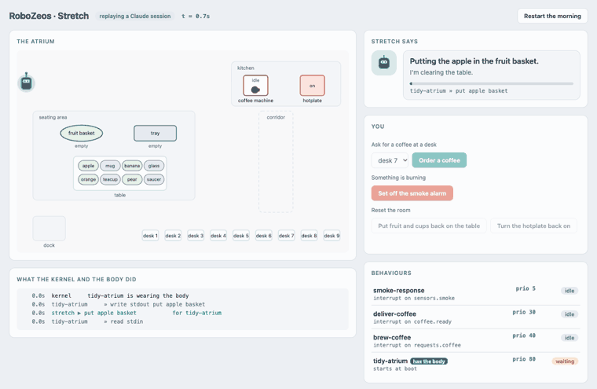
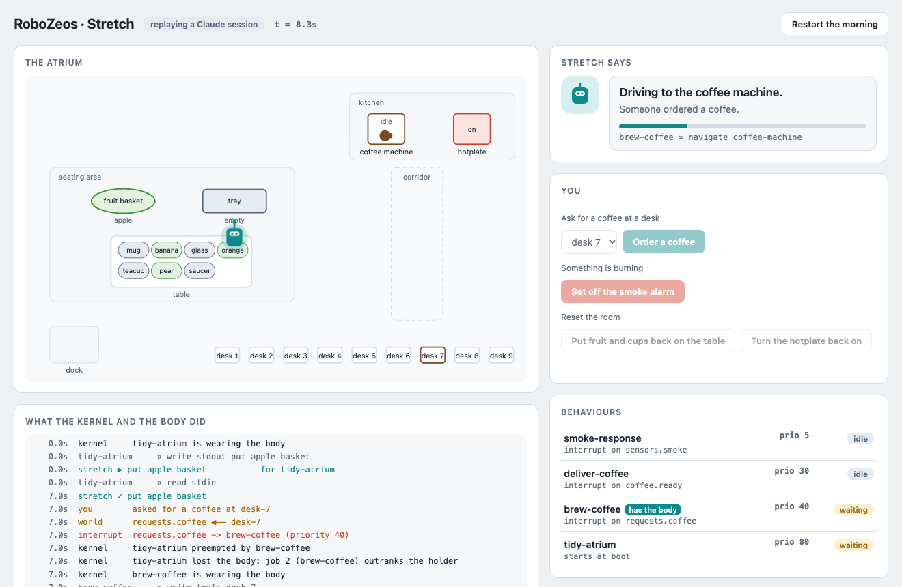
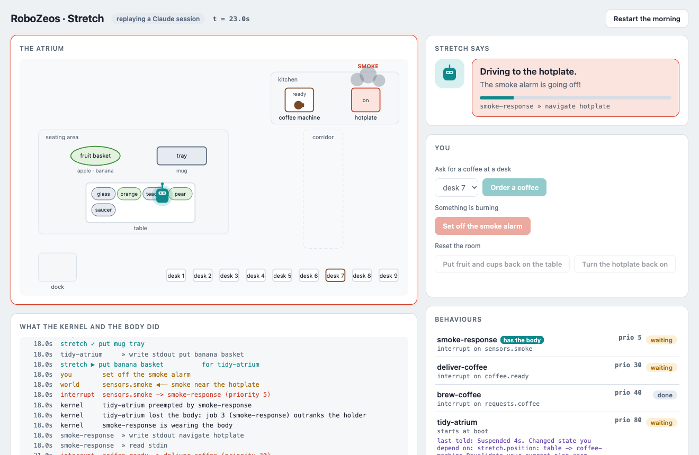
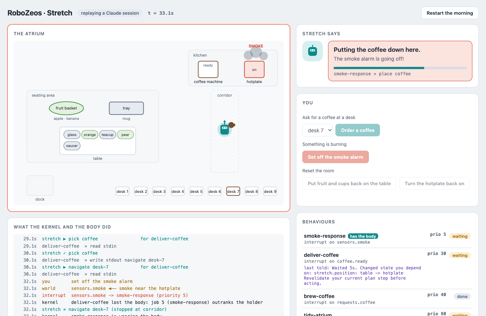
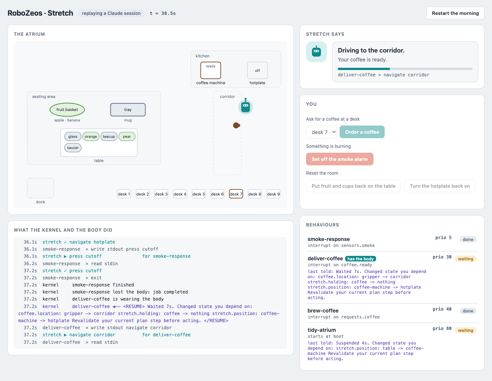
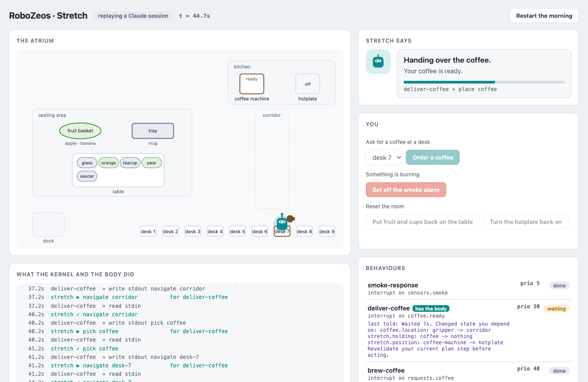

# zeos-stretch: one robot, four behaviours



Stretch is clearing the table in the seating area of the RoboZeos Atrium, putting the fruit
in the basket and the mugs, glasses and saucers on the tray, when somebody asks for a
coffee. The coffee outranks the tidying, so Stretch goes to the coffee machine and starts
one; while it brews, Stretch goes back to the table rather than standing idle. When the
coffee is ready Stretch fetches it, and if the smoke alarm goes off on the way to the
desk, Stretch puts the coffee down, drives to the hotplate and presses the cut-off. Then
it goes back for the coffee, delivers it, and finishes clearing the table.

Nothing in any behaviour mentions another. Each is written as if it were the robot's
only job, and the kernel makes the morning out of four integers and three vectors.

## A morning with Claude, in five pictures

These are frames of the live page playing back
[`recordings/claude-morning`](recordings/claude-morning), a session in which Claude chose
every command and a person clicked the page's buttons: a coffee for desk 7, then the smoke
alarm twice.

**1. A coffee is ordered.** Clicking *Order a coffee* writes `desk-7` to
`requests.coffee`, and that pipe is bound in the vector table: the write is an interrupt
that starts `brew-coffee` at priority 40, which outranks the tidying at 80. The tidying
had just put the apple in the basket and had nothing in hand, so the body was the
coffee's at once. `brew-coffee` records the order, starts the machine and exits, and the
tidying gets the body back while the coffee brews.



**2. The alarm, while tidying.** The tidying is putting the banana away when *Set off the
smoke alarm* is clicked. `smoke-response` is priority 5 and takes the body, but the
tidying's release policy is `at-action-boundary`, so the banana goes in the basket before
the body drives to the hotplate. The coffee finishes brewing meanwhile, and
`deliver-coffee` waits for the body behind the alarm.



**3. The alarm again, mid-delivery.** `deliver-coffee` has the coffee and is driving it
to desk 7 when the alarm is set off a second time. The delivery's policy is `immediate`,
so the body stops in the corridor and obeys the alarm there and then: it puts the coffee
down and goes back to the hotplate.



**4. The delivery is told what moved while it was away.** When the alarm is dealt with,
`deliver-coffee` gets the body back with a RESUME notice naming only what something else
changed: the coffee is no longer in the gripper but in the corridor, and the body is at
the hotplate. Claude reads that and drives back to the corridor for the coffee. Its own
earlier moves are not in the notice, because the body reported them on its behalf.



**5. Delivered.** The coffee reaches desk 7, and the tidying gets the body back to finish
the table. The recording goes on to a third alarm and a second coffee, for desk 5.



## Running it

```bash
uv sync --extra claude
uv run zeos-stretch lint                    # check the case tree without running it
uv run zeos-stretch run                     # the scripted morning, as the kernel and the body saw it
uv run zeos-stretch run --journal out.jsonl # and keep the journal
uv run zeos inspect out.jsonl
uv run pytest                               # the story, asserted on the journal
```

None of that needs a key. `uv sync` without `--extra claude` is enough for it.

## Watching it, and driving it

```bash
uv run zeos-stretch serve                           # the scripted morning, in a browser page
uv run zeos-stretch serve --speed 3                 # three times as fast
uv run zeos-stretch serve --replay recordings/claude-morning   # the session in the pictures
cp .env.example .env                                # then put your Claude key in it
uv run zeos-stretch serve --machine claude          # you decide when things happen
```

The page shows the atrium's floor plan with Stretch moving on it, what Stretch says it
is doing and why, the four behaviours with their state and who is wearing the body, and
the kernel's narration as it happens. Under `--machine claude` you drive the morning:

- **Order a coffee** at any of `desk-1` to `desk-9`, which is a write to
  `requests.coffee` and so the coffee-order interrupt;
- **Set off the smoke alarm**, a write to `sensors.smoke`;
- **Put fruit and cups back on the table** once it is clear, which lays it again and
  starts a fresh `tidy-atrium`;
- **Turn the hotplate back on** after the alarm has cut it.

`.env` is read from the current directory and then this one; a variable already in the
environment wins over it, and `--model` wins over `ANTHROPIC_MODEL`.

Without a model the tapes only fit the case's own schedule, so plain `serve` replays
that and the controls stay off. `--machine tape` takes your clicks but still answers from
the tapes, which is only right if you click when they expect it.

The atrium's clock follows the wall clock, except while a behaviour is waiting for
Claude to choose its next command. A seat is synchronous, so the kernel cannot run
during that call, and the atrium waits with it rather than let the body finish actions
that nobody could answer; the page says when that is happening. Anything you do
meanwhile is delivered when the call returns.

## Recording and replaying a session

Every live session, under `--machine claude` or `--machine tape`, is recorded to a new
directory under `runs/` (ignored by git), and the terminal says where. A recording holds
the time of every step, what was clicked and when, every command the model answered
with and the reply it was picked out of, the journal as it was written, and a copy of
the case as it was played.

```bash
uv run zeos-stretch run --replay recordings/claude-morning   # in the terminal
uv run zeos-stretch serve --replay latest                    # the newest run, in the page
```

A replay asks no model and needs no key: each turn is answered with the command that was
recorded for it. Against the kernel it was recorded with, the terminal replay reproduces
the journal byte for byte, and says so; against a newer kernel the same commands still
play, and the story's claims are checked again. `--record DIR` chooses the directory, and
`--no-record` turns recording off.

## The behaviours

| file | priority | started by | what it does |
| --- | --- | --- | --- |
| `goals/tidy-atrium.md` | 80 | boot | clears the table: fruit to the basket, tableware to the tray |
| `handlers/brew-coffee.md` | 40 | `requests.coffee` | records the order, drives to the machine, starts it, exits |
| `handlers/deliver-coffee.md` | 30 | `coffee.ready` | fetches the coffee and delivers it |
| `handlers/smoke-response.md` | 5 | `sensors.smoke` | puts down what it holds, presses the hotplate cut-off |

The wait for the coffee is not a wait inside any behaviour. `brew-coffee` exits once the
machine is running, which hands the body back, and the machine's own interrupt starts
`deliver-coffee` when the coffee is ready. That is what lets the tidying fill the brew.

## The body is a lease

`platforms/stretch.yaml` declares the one body, and every behaviour that moves it
declares `requires:`. Wearing the body is holding its lease. When a behaviour needs the
body and outranks its wearer, the kernel books a revocation for after the grace of the
wearer's `release_policy`, then takes the body back for the most urgent claimant; the
journal says so in `fleet.disembodied`, with the reason "job N (name) outranks the
holder".

- `tidy-atrium` is `at-action-boundary`: the body finishes the item in hand before it
  obeys anyone else. Each `put` goes from gripper empty to gripper empty, so that boundary
  is always a moment the gripper is free; nobody who takes the body from the tidying
  inherits a banana.
- `deliver-coffee` is `immediate`: stopping mid-move harms nothing, since the body keeps
  hold of the coffee, so the alarm has the body at once.

A behaviour that has lost the body cannot command it. If it runs, it waits for the lease
like any other claimant, which is why the delivery cannot countermand the smoke handler
while the handler is driving.

## The VLA is a device

The demonstration assumes a VLA that understands the commands, always carries them out,
and reports the resulting state. `src/zeos_stretch/vla.py` simulates one in virtual
time, and is the only file a real VLA replaces. Its contract with the kernel is four
kinds of pipe and two journal events:

| direction | channel | what travels |
| --- | --- | --- |
| kernel to body | `stretch.command` (a sink) | one command from the wearer, such as `navigate coffee-machine` |
| body to kernel | `stretch.done.<behaviour>` | the answer to that behaviour: `done ...`, `interrupted ...` or `refused ...` |
| body to kernel | `report.*` (actuators) | the physical state after the action: `stretch.position`, `stretch.holding`, `table.items`, `basket.contents`, `tray.contents`, `coffee.location`, `coffee.machine`, `hotplate.power` |
| kernel to body | `fleet.embodied` / `fleet.disembodied` | who the body should obey, and when to stop |

The vocabulary is `navigate PLACE`, `put ITEM basket|tray`, `pick coffee`,
`place coffee`, `brew` and `press cutoff`. A command whose preconditions do not hold,
such as putting away an item that is not on the table, is refused and changes nothing,
and a behaviour that sends a second command before reading the answer to its first is
refused too. Which container an item belongs in is the tidying behaviour's decision: the
VLA puts an item wherever it is told. The cup the machine fills is called `coffee`
throughout, so it is never confused with the mugs and teacups on the table.

Reports are made `on_behalf_of` the behaviour whose command caused them, so a behaviour
is never told about its own effects when it resumes, and every other behaviour is. Where
the body stopped when an alarm cut a move short is the body's own report, not attributed
to the move, because it is news to the behaviour that asked for it.

## Scripts and models

Every behaviour's turn goes through a `CommandSeat`, which spends one decode per word,
parses each closed command into a kernel request, and rebuilds the behaviour's
transcript from its context each time it is asked to speak. What the behaviour says next
comes from a command source, and the kernel cannot tell which one it is:

```bash
uv run zeos-stretch run                                  # the descriptors' own tapes
uv run zeos-stretch run --commands                       # and every command as it was parsed
uv run zeos-stretch run --machine claude --commands      # the Claude API, one call per command
uv run zeos-stretch run --machine claude --model claude-sonnet-5
```

A behaviour speaks the default syscall ABI: `write PIPE TEXT;`, `read PIPE;`, `say
TEXT;` and `exit;`, naming only `stdin` (the body's answers), `stdout` (the body's
commands) and, for `brew-coffee`, `tools` (where the order goes).

**A tape** is the `script:` list in each descriptor: the exact commands, in order. It
cannot read a resume notice, so `deliver-coffee`'s tape has the detour to the corridor
written in, and it is right only for the schedule in `cases/atrium/events.jsonl`. It makes
the run reproducible byte for byte, which is what the tests pin.

**Claude** reads the descriptor body, the STATUS lines and the RESUME notices, and
decides each command itself: which container an item belongs in, where the order is
going, and, after an alarm, that the coffee is now in the corridor. `deliver-coffee`'s
body is written as rules over its three STATUS lines (where the coffee is going, where it
is, where the body is), so each command follows from what is true now rather than from a
plan the alarm has overtaken. The kernel checks every command exactly as it checks a
tape's, and a reply with no command in it becomes a `MALFORMED` fault that
`on_fault: retry` answers with a notice. The request asks for `claude-opus-5` at high
effort, with server-side fallback on refusal.

A run under a model is not reproducible, so it is judged by what the morning must come
to rather than by its journal line for line. `src/zeos_stretch/story.py` states those
claims, and `zeos-stretch run` prints them at the end of every run and exits non-zero if
one fails:

```
  ✓ the table is clear
  ✓ the fruit is in the basket
  ✓ the tableware is on the tray
  ✓ the coffee reached desk-7, where it was ordered
  ✓ the hotplate is off
  ✓ no command was faulted (0 were)
  ✓ the coffee took the body from the tidying at an action boundary
  ✓ the alarm took the body mid-delivery, without waiting
```

The first six are the behaviours' work and depend on the model; the last two are the
kernel's and hold under any model. Virtual time does not include the model's own
latency: each command costs one API call in wall-clock time and ten milliseconds of the
atrium's.

## Filming the page

The pictures above come from `scripts/capture.py`, which plays a recording back in the
page in a headless Chrome and saves a still at each moment the walkthrough names. It
drives the Chrome already installed:

```bash
uv run --with playwright --with pillow python scripts/capture.py [RECORDING]
```
